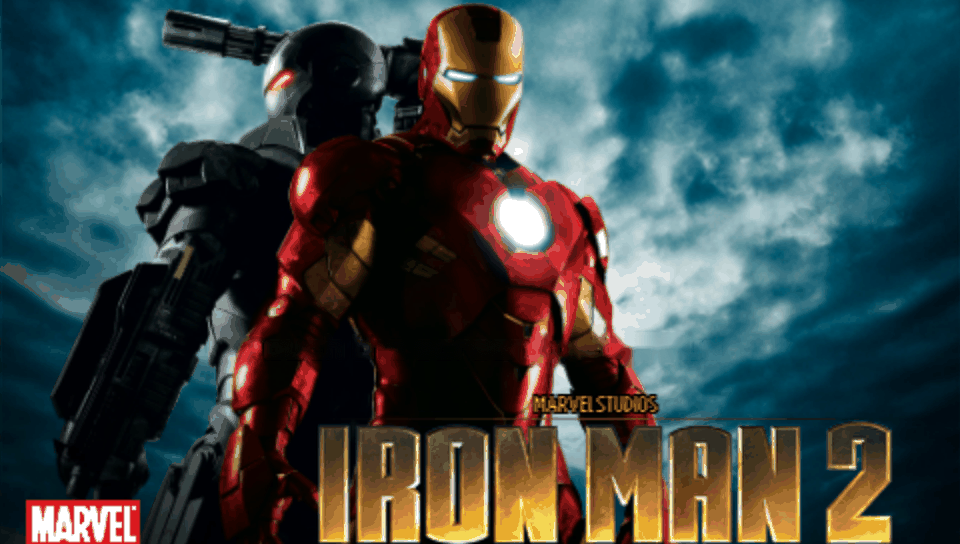

<h1 align="center">
  <br>
  Iron Man 2 · PS Vita Port
</h1>

<p align="center">
  <a href="#-status--playability">Status & Playability</a> •
  <a href="#setup-instructions-for-players">How to install</a> •
  <a href="#controls">Controls</a> •
  <a href="#known-issues">Known Issues</a> •
  <a href="#build-instructions-for-developers">How to compile</a> •
  <a href="#credits--acknowledgments">Credits</a>
</p>

An unofficial, native **iOS-to-PS Vita wrapper port** of *Iron Man 2* (iPhone version by **Gameloft**, 2010). There is no `.so` here: this port ships its own **Mach-O loader** that maps the official armv6 iOS executable (`IronMan2`, from the 1.0.3 IPA) into PS Vita RAM and replaces the Apple frameworks it uses (Foundation, UIKit, CoreFoundation, QuartzCore, AudioToolbox, OpenAL, OpenGL ES, MediaPlayer) with native implementations on top of **vitaGL**, **openal-soft** and the Vita system libraries.

---

## 🎮 Status & Playability

**Status: WIP (not tested on console yet)**

The port has only been run in the ARM32 host test (`hosttest/`, the same loader and runtime built for Linux ARM32 in Docker). There it boots, shows the Marvel/Gameloft logos and reaches the title screen of the Flash (gameswf) menu. **No run on physical PS Vita hardware yet.**

- [x] **Mach-O loader**: loads the armv6 executable at a fixed base (`MACHO_SLIDE = 0x98000000`), applies **33,468** rebase words, resolves **6,013** import slots (0 unimplemented imports), runs the **297** global constructors and enters `UIApplicationMain`. *Host test only.*
- [x] **VFP vector code**: the 162 ARMv6 VFP short-vector blocks (Irrlicht `CMatrix4` math, unsupported on the Vita's Cortex-A9) are rewritten to NEON at load time. *Host test only.*
- [x] **Graphics**: GLES 1.x (Irrlicht 1.4.2 + gameswf) → **vitaGL** (`SOFTFP_ABI=1`). The game runs as a 480×320 landscape iPhone and is shown at **816×544 with side bars** (aspect kept). *Host test only.*
- [ ] **Touch & Controls**: front touch is delivered to the game view; physical buttons are mapped to touches through `controls.txt`. Not tested on console.
- [ ] **Audio**: OpenAL (sound effects and the IMA ADPCM `.www` music decoded by the game). Not tested on console.
- [ ] **Saves**: iOS `Documents/` is redirected to `ux0:data/ironman2/Documents/`. Not tested on console.
- [ ] **In-game (missions)**: not reached yet.
- [ ] **Trophies**: not implemented.

---

## Disclaimer

**Iron Man** and all related characters are trademarks of **Marvel**. The iPhone game *Iron Man 2* was developed and published by **Gameloft**. The work presented in this repository is unofficial and is not produced, endorsed, or sanctioned by Marvel, Gameloft or any affiliated entities.

This software does NOT contain original game code, binaries, copyrighted graphics, or game assets. The authors do not promote or condone piracy in any way. To play, you must provide your own legally obtained, **decrypted** copy of the iOS `.ipa`.

---

## Setup Instructions (For Players)

1. **CFW & Plugins**: PS Vita on Custom Firmware (**Enso 3.60 / 3.65** recommended) with `kubridge` under `*KERNEL` in `ur0:tai/config.txt`:
   ```ini
   *KERNEL
   ur0:tai/kubridge.skprx
   ```
2. **Shader Compiler**: `libshacccg.suprx` must be in `ur0:data/` (extract it with **ShaRKBR33D**).
3. **Game Files**: a decrypted **Iron Man 2 1.0.3** iOS `.ipa` (FairPlay `cryptid 0`, `CFBundleVersion 1.0.3`, thin armv6). Open it as a ZIP and extract `Payload/IronMan2.app/`. No other version works with the generated `rebase.bin` / `binds.bin`.
4. **Copy to the Vita** (`ux0:data/ironman2/`, about 1 GB):
   ```
   ux0:data/ironman2/
     game_app/      the contents of IronMan2.app from the IPA, untouched (renamed to game_app)
     rebase.bin     generated with tools/stage_data.sh
     binds.bin      generated with tools/stage_data.sh
     nib.txt        generated with tools/stage_data.sh (MainWindow.nib, precompiled)
     nibs/          generated with tools/stage_data.sh (other .nib files)
     controls.txt   optional — button → touch mapping (see Controls)
     Documents/     created automatically — your saves
     logs/          created automatically — ironman2_001.log … one per run
   ```
5. **Install VPK**: install `ironman2.vpk` with VitaShell.

---

## Controls

Physical buttons are translated into touches at fixed points of the screen. The points are set in `ux0:data/ironman2/controls.txt` (coordinates on the 480×320 game screen, editable without recompiling). A `STICK x y r` line turns the left stick into a finger dragged around `(x, y)` (on-screen joystick).

| Input | Action | Status |
| :---: | :--- | :---: |
| **Front Touchscreen** | iPhone touch screen (menus, HUD) | ⚠️ Not tested on console |
| **Buttons / Left Stick** | Touches defined in `controls.txt` | ⚠️ Not tested on console |
| **Select + Start (hold 2 s)** | Cycle the picture rotation (saved to `rotation.txt`) | ⚠️ Not tested on console |

> [!TIP]
> The mapping file format is described in [`tools/controls.example.txt`](tools/controls.example.txt). Each line is `BUTTON X Y`.

---

## Known Issues

- **Early build**: only the host test has been run; expect crashes on the first console runs.
- **Side bars**: the picture is not stretched to 16:9.
- **Online features disabled**: Gameloft online services, IGP ("more games") and the in-app store are not available.
- **Crash dumps** are written by the system to `ux0:data/` (not to the game folder).

---

## Build Instructions (For Developers)

### Prerequisites

- [VitaSDK](https://vitasdk.org/) (`$VITASDK`, softfp) with `vitaGL` (vendored), `vitashark`, `openal-soft`, `libvorbis`/`libogg`, `freetype`, `libpng`, `zlib`, `bzip2` and `mathneon`.
- CMake 3.14+, Python 3 with `capstone` (for the tools).
- The decrypted `IronMan2.app` folder, linked as `game_app` in the repo root (never committed).

### Compilation Commands

```bash
git clone https://github.com/Gh0sTRX/iron-man-2-mach-o.git
cd iron-man-2-mach-o
ln -s /path/to/Payload/IronMan2.app game_app

# Stage the console data (copies the .app, generates rebase.bin / binds.bin / nib.txt)
tools/stage_data.sh

# Build eboot.bin / ironman2.vpk
cmake -S . -B build
cmake --build build
```

### Deploy & Debug (over VitaShell FTP)

```bash
python3 -I tools/deploy_data.py          # upload ux0_data/ironman2/
python3 -I tools/deploy_data.py --logs   # fetch logs and crash dumps into ./logs/
```

### Host test (no console)

```bash
hosttest/run.sh build                     # Docker, Linux ARM32 softfp
HOSTTEST_FRAME_S=15 hosttest/run.sh run 420
# logs: build/hosttest-data/ironman2/logs/   screenshots: build/hosttest-data/frames/
```

A crash PC in `0x98xxxxxx` minus `0x98000000` is the address in the Mach-O: look it up with `python3 -I tools/annotate.py`. A data address below `0x02000000` (or a pointer rebased twice, `0x30xxxxxx`) means a wrong rebase (see `report.txt`). Architecture and progress notes: [`PORTING_PLAN.md`](PORTING_PLAN.md) and [`port_progress.md`](port_progress.md).

---

## Credits & Acknowledgments

- **Iron Man 2** is intellectual property of **Marvel**; the iPhone version was developed by **Gameloft** on top of the Irrlicht engine and gameswf.
- Project by [Gh0sTRX](https://github.com/Gh0sTRX).
- **vitaGL** graphics library by [Rinnegatamante](https://github.com/Rinnegatamante/vitaGL).
- **kubridge** plugin by [Bythos](https://github.com/bythos14/kubridge).
- **openal-soft**, **FreeType**, **libpng** and **zlib** projects.
- The **iOS Mach-O loader** and shared runtime come from [MetalSyntax](https://github.com/MetalSyntax)'s iOS ports: [`ios-loader-boilerplate`](https://github.com/MetalSyntax/ios-loader-boilerplate), [`Inotia2-vita`](https://github.com/MetalSyntax/Inotia2-vita) and [`Ferrari-GT-Evolution-vita`](https://github.com/MetalSyntax/Ferrari-GT-Evolution-vita).
- Special thanks to the PS Vita homebrew and porting community.
